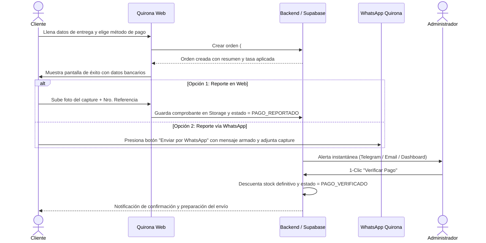

# 🛍️ Quirona — E-Commerce Boutique

Documento maestro de arquitectura, requerimientos de negocio, experiencia visual y hoja de ruta técnica para la tienda online **Quirona**.

---

## 📌 1. Visión General del Proyecto

* **Nombre de la marca:** Quirona Store
* **Concepto:** Tienda online boutique con estética *retro-vintage pop / streetwear*, enfocada en prendas de vestir (ropa) y categorías secundarias de moda y estilo.
* **Propuesta clave:** 
  * **Experiencia visual 3D:** Hero Section inmersivo con una mascota/estrella 3D inflada (*puffy star*) interactiva en Three.js.
  * **Catálogo detallado para moda:** Soporte completo de variantes (Talla + Color + Stock independiente por combinación) y guía interactiva de medidas (cm).
  * **Moneda dual inteligente:** Precios base en USD para proteger de inflación, con conversión en tiempo real a moneda local (VES) según tasa del día.
  * **Logística sin trabas:** Precios de envío acordados posteriormente con el cliente según su zona o encomienda (MRW, Zoom, Tealca, Delivery local o Retiro personal).
  * **Checkout asistido & Pago manual automatizado:** Proceso de verificación manual sin comisiones bancarias externas, pero con reporte híbrido (Web + WhatsApp directo) y panel administrativo de verificación en 1 clic.

---

## 🎨 2. Identidad Visual y Sistema de Diseño

* **Logo Oficial:**
  * Archivo en el proyecto: [`assets/logo_quirona.jpeg`](file:///home/parz7val/Documents/quirona/assets/logo_quirona.jpeg)
  * Imagen de referencia de paleta: [`assets/WhatsApp Image 2026-09-17 at 7.58.05 PM.jpeg`](file:///home/parz7val/Documents/quirona/assets/WhatsApp%20Image%202026-09-17%20at%207.58.05%20PM.jpeg)
  * Descripción visual: Estrella inflada/redondeada de 5 puntas estilo cartoon retro-vintage con tipografía gruesa setentera *"Quirona Store"* en crema con bordes vino tinto y destellos dorados.

* **Paleta de Colores Oficial (Hexadecimal):**
  * `Primary / Star Yellow`: **`#FFDD48`**
    * *Uso:* Color estrella de la marca, llamadas a la acción destacadas (CTA), badges de ofertas, acento 3D.
  * `Deep Contrast / Dark Burgundy`: **`#661716`**
    * *Uso:* Tipografía de alto contraste, bordes gruesos retro, sombras profundas, botones de compra oscuros, footer.
  * `Warm Neutral / Sage Sand`: **`#DAD6BB`**
    * *Uso:* Fondo general de la aplicación (Background), secciones alternadas, contraste orgánico cálido.
  * `Soft Butter Cream`: **`#FFECB9`**
    * *Uso:* Fondos de tarjetas de producto, inputs, modales, selector de tallas y superficies elevadas.

* **Configuración Tailwind CSS:**
  ```javascript
  colors: {
    quirona: {
      bg: '#DAD6BB',        // Sage Sand (Fondo base)
      yellow: '#FFDD48',    // Star Yellow (Acento estrella)
      burgundy: '#661716',  // Deep Burgundy (Texto / Bordes / Contraste)
      cream: '#FFECB9',     // Soft Butter Cream (Superficies y Cards)
    }
  }
  ```

* **Tipografía recomendada:**
  * Títulos y Hero: Tipografía display retro-bold (tipo *Syne*, *Recleta*, *Clash Display* o *Cooper Black / Bricolage Grotesque*).
  * Textos y UI de tienda: *Plus Jakarta Sans* o *Inter* para máxima legibilidad en precios, tallas y filtros.
* **Estilo estético:** Vintage pop / Retro streetwear boutique (cálido, desenfadado, divertido y con alta personalidad).

---

## 🌐 3. Estructura de Páginas y Funcionalidades

### A. Página Principal (Home)
1. **Top Bar Informativa:**
   * Tasa de cambio del día (ej. `Tasa oficial: 1 USD = XX.XX VES`).
   * Mensaje de atención / envíos a todo el país.
2. **Navbar Fijo con efecto Blur:**
   * Logo de Quirona Store.
   * Navegación: Inicio, Catálogo, Ropa, Novedades, Contacto.
   * Icono de Búsqueda instantánea.
   * Icono de Carrito con badge dinámico de prendas seleccionadas.
3. **Hero Section 3D (Three.js / React Three Fiber):**
   * **Objeto 3D:** La estrella inflada "Quirona" (*Puffy Star*) en material brillante/satinado con los colores oficiales (`#FFDD48` y bordes `#661716`).
   * **Interactividad:**
     * Rotación suave continua y flotación con física senoidal.
     * Reacción dinámica a la posición del cursor (inclinación / tilt suave) o acelerómetro en móvil.
     * Al hacer clic/tap en la estrella, realiza un pequeño salto/rebote con efecto elástico y libera partículas de destellos dorados (`#FFECB9`).
   * **Titular & CTA:** Tipografía con carácter boutique, frase de impacto y botón *"Ver Colección"*.
4. **Categorías Destacadas:**
   * Ropa (Vestidos, Tops/Camisetas, Pantalones, Abrigos/Hoodies).
   * Otras categorías secundarias (Accesorios, Gorras, Calzado, Bolsos).
5. **Sección de Novedades y Más Populares:**
   * Grid de tarjetas con cambio de foto en hover, selector rápido y badges.
6. **Políticas y Confianza:**
   * Envíos nacionales seguros, atención personalizada vía WhatsApp, pagos fáciles en bolívares o divisas.
7. **Footer:**
   * Redes sociales, botón de WhatsApp, enlaces legales y datos de contacto.

---

### B. Catálogo de Productos y Ficha de Prenda
1. **Filtros & Navegación:**
   * Filtro por categoría (Ropa, Accesorios, etc.).
   * Filtro por Talla (XS, S, M, L, XL, Talla Única).
   * Filtro por Color (muestras circulares de color).
   * Filtro por rango de precio (USD / VES).
   * Ordenar por: Más recientes, Menor precio, Mayor precio.
2. **Búsqueda en Tiempo Real:** Filtra instantáneamente por nombre o etiqueta.
3. **Ficha de Detalle de Prenda:**
   * Galería de fotos con zoom y selector de miniaturas.
   * **Selector de Color & Talla:**
     * Muestra visualmente las combinaciones disponibles.
     * Si una combinación (ej. Beige Talla M) no tiene stock, se deshabilita con badge "Agotado".
     * Muestra el stock disponible en tiempo real.
   * **Guía Interactiva de Tallas (Modal / Acordeón):**
     * Tabla con medidas en centímetros (Pecho/Busto, Cintura, Cadera, Largo total).
     * Instrucciones de cómo medirse en casa.
   * **Visualización de Precios Dual:**
     * Precio en USD (ej. `$25.00`).
     * Conversión a VES calculada en vivo según la tasa (ej. `Bs. 1.150,00`).
   * **Botones:** "Añadir al Carrito" y "Comprar Ahora".

---

### C. Carrito de Compras (Drawer Deslizable)
1. **Drawer Lateral Interactivo:**
   * Se abre sin recargar la página desde cualquier parte de la tienda.
   * Muestra cada prenda con: foto miniatura, nombre, color seleccionado, talla elegida, precio unitario y selector de cantidad (+ / - / eliminar).
2. **Resumen de Costos:**
   * Subtotal en USD y en VES.
   * **Envío:** Indicador claro: *"Envío por coordinar según destino (Retiro gratis / Delivery / Encomienda)"*.
   * Total actual a pagar en USD y VES.
3. **Persistencia:** Si el cliente recarga o cierra el navegador, sus prendas quedan guardadas en `localStorage` (vía Zustand).
4. **Botón Principal:** *"Continuar al Checkout"*.

---

## ⚡ 4. Flujo de Checkout y Pago Manual Automatizado

> **Definición Clave:** Proceso sin pasarela de cobro bancaria externa, pero 100% automatizado en la generación de órdenes, cálculos de conversión y canales de recepción.



### Paso 1: Formulario de Checkout Rápido
* Datos del cliente: Nombre y Apellido, WhatsApp de contacto, Cédula/ID.
* Método de entrega:
  * **Retiro Personal** (Punto de entrega acordado en la ciudad - Gratis).
  * **Delivery Local** (Zona urbana - Costo a coordinar con mensajero).
  * **Envío Nacional** (MRW, Zoom, Tealca - Cobro en destino / a coordinar).
* Método de pago manual seleccionado:
  * **Pago Móvil** (muestra Banco, Cédula, Teléfono y monto exacto en Bs).
  * **Transferencia Bancaria en Bs** (muestra Cuenta, Titular, Cédula).
  * **Zelle** (muestra correo y titular).
  * **Efectivo** (solo retiro personal).

### Paso 2: Generación Automática del Pedido (Código `#QN-XXXX`)
* Se genera la orden en base de datos.
* Se congelan temporalmente las prendas seleccionadas para evitar sobreventas.
* Se muestra la pantalla de confirmación con los datos bancarios y el monto total en USD y Bs.

### Paso 3: Reporte Híbrido del Pago
* **Canal Web:** El cliente puede subir el capture de la transferencia o Pago Móvil y escribir los 4-6 últimos dígitos de la referencia. La imagen queda almacenada en el storage seguro del proyecto.
* **Canal WhatsApp (1-Click):** Un botón verde prominente genera automáticamente un enlace de WhatsApp con el mensaje estructurado:
  ```text
  ¡Hola Quirona Store! 👋 Acabo de generar mi pedido #QN-8492:
  
  🛍️ Prendas:
  - 1x Blusa Satinada (Color: Amarillo, Talla: M) - $25.00
  - 1x Pantalón Wide Leg (Color: Beige, Talla: S) - $38.00
  
  💵 Total a pagar: $63.00 (Bs. 2.898,00)
  💳 Método: Pago Móvil
  🚚 Entrega: Envío Nacional MRW (Por coordinar)
  👤 Cliente: María Gómez (0412-1234567)
  
  Adjunto el comprobante de pago: 📎
  ```

### Paso 4: Verificación en 1 Clic para el Administrador
* El administrador recibe una alerta (Telegram Bot / Dashboard).
* Puede ver el comprobante y los datos del cliente.
* Al hacer clic en **"Verificar Pago"**:
  1. Se descuenta el stock de forma permanente.
  2. La orden cambia a `PAGO_VERIFICADO`.
  3. Se habilita el envío de mensaje al cliente para coordinar el despacho.

---

## 🛠️ 5. Stack Tecnológico & Endpoints de Backend

| Capa | Tecnología | Justificación |
| :--- | :--- | :--- |
| **Frontend Framework** | **Next.js 15+ (App Router)** | Renderizado híbrido ultra veloz, SEO optimizado para ropa, Server Components y Route Handlers. |
| **Animación 3D** | **Three.js + `@react-three/fiber` + `@react-three/drei`** | Canvas interactivo nativo en React para la mascota/estrella 3D del Hero, con control de FPS en móvil. |
| **Estilos & UI** | **Tailwind CSS + Lucide React** | Diseño retro-boutique personalizado con la paleta oficial, microinteracciones fluidas y componentes accesibles. |
| **Gestión de Estado** | **Zustand (con persistencia `localStorage`)** | Carrito de compras ultra rápido, persistente y sin re-renders innecesarios. |
| **Persistencia de Catálogo** | **JSON Store local + Supabase Ready** | Persistencia inmediata en servidor (`src/data/products.json`) y preparado para migración directa a PostgreSQL. |
| **Panel de Administración** | **Ruta `/admin`** | Interfaz visual completa para subir prendas, ajustar stock por talla/color y modificar la tasa de cambio. |

### Endpoints de API Implementados:
* `GET /api/products`: Devuelve todas las prendas con sus variantes de tallas, stock y medidas en cm.
* `POST /api/products`: Da de alta un nuevo producto con validación de categorías, tallas y tabla de medidas.
* `PUT /api/products/[id]`: Actualiza campos, precio o stock de una prenda existente.
* `DELETE /api/products/[id]`: Elimina un producto del catálogo.
* `POST /api/upload`: Recibe y guarda archivos de imagen directamente en `public/uploads/` retornando la URL pública para la prenda.

---

## 🚀 6. Fases de Implementación

1. **Fase 1: Inicialización y Design System**
   * Estructura base en Next.js 15 + Tailwind CSS con las variables de color oficiales (`quirona-yellow`, `quirona-burgundy`, `quirona-bg`, `quirona-cream`).
   * Configuración de fuentes tipográficas y layout principal (Navbar con logo, TopBar con tasa, Footer).
2. **Fase 2: Hero Section 3D con Three.js**
   * Modelado procedural / malla de la estrella inflada 3D de Quirona con shaders satinados.
   * Interactividad al cursor/tap, físicas elásticas y partículas de brillo.
   * Fallback visual ligero para dispositivos de bajo rendimiento.
3. **Fase 3: Catálogo, Variantes de Ropa y Guía de Tallas**
   * Esquema de productos con soporte para color, talla y medidas en cm.
   * Grid de productos con filtros en tiempo real, búsqueda y modal de detalle.
   * Conversión en vivo USD / VES.
4. **Fase 4: Carrito Deslizable y Checkout Asistido**
   * Drawer lateral de carrito con cálculo en vivo.
   * Formulario de checkout con selección de retiro/delivery/encomienda y método de pago manual.
   * Generación de código `#QN-XXXX`.
5. **Fase 5: Reporte Híbrido y Panel Admin de Verificación**
   * Componente para subir capture de pago en la web.
   * Generador de URL preformateada para WhatsApp.
   * Panel privado `/admin` con gestión de stock, tasa del día y botón 1-click para verificar órdenes.

---

## 📝 7. Registro de Decisiones de Negocio (Confirmadas)

- [x] **Moneda:** Precios base en USD con conversión automática a VES según tasa del día.
- [x] **Reporte de Pago:** Modelo Híbrido (subida de comprobante en web + botón directo formateado de WhatsApp).
- [x] **Cálculo de Envío:** Posterior / Por coordinar con el cliente según su zona o agencia de envíos.
- [x] **Variantes de Ropa:** Talla + Color + Guía interactiva de medidas (cm) con control de stock por variante.
- [x] **Identidad Visual:** Logo y paleta de 4 colores integrada en el sistema (`#FFDD48`, `#661716`, `#DAD6BB`, `#FFECB9`).
- [x] **Concepto 3D del Hero:** Estrella inflada interactiva (*Puffy Star*) inspirada en el logo con partículas de destellos.
