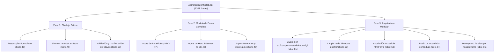

# Informe de Auditoría Estructural — Quadrant-06-Solo: AdminSiteConfigTab.tsx
**Motor:** Auditoría de Calidad de Software en Sandbox  
**Proyecto:** Quirona Store  
**Fecha:** 12 de Octubre de 2026  
**Archivo Auditado:** `src/components/admin/AdminSiteConfigTab.tsx` (1,301 líneas)  
**Estado:** ✅ **Completado y Certificado — 12 Hallazgos Catalogados (SEC-45 a SEC-56)**  

---

## 🏛️ Resumen Ejecutivo
Se ejecutó una revisión estructural exhaustiva y profunda sobre el componente monolítico `AdminSiteConfigTab.tsx` (1,301 líneas, 21 variables de estado React y 4 integraciones API: `/api/site-config`, `/api/exchange-rate`, `/api/admin/telegram-test`, `/api/admin/credentials`).

### Evaluación de Clean UI & Retro Design System:
- **Clean UI (`GEMINI.md` / `clean-ui-styling`):** ✅ **100% Conforme**. No se encontraron emojis de estrellas (`✨`, `⭐`, `🌟`, `★`, `☆`, `✦`, `✧`) ni iconos genéricos `<Sparkles />` de `lucide-react`.
- **Paleta Oficial Retro:** Uso consistente y estricto de:
  - Primario amarillo estrella: `#FFDD48` (`bg-quirona-yellow`, `text-quirona-yellow`)
  - Vino tinto / Borgoña: `#661716` (`bg-quirona-burgundy`, `text-quirona-burgundy`)
  - Neutro arena cálido: `#DAD6BB` (`bg-quirona-bg`)
  - Crema mantequilla: `#FFECB9` (`bg-quirona-cream`)
- **Iconografía Aprobada:** `<Save />`, `<Smartphone />`, `<Building2 />`, `<CreditCard />`, `<MessageCircle />`, `<FileText />`, `<CheckCircle2 />`, `<Send />`, `<Bell />`, `<Volume2 />`, `<AlertCircle />`, `<RefreshCw />`, `<ShieldCheck />`, `<Lock />`, `<KeyRound />`, `<Clock />`, `<ShieldAlert />`.

---

## 📋 Catálogo Detallado de Hallazgos Estructurales

| ID | Severidad | Categoría | Estado | Descripción del Hallazgo |
| :--- | :--- | :--- | :--- | :--- |
| **SEC-45** | **Alta** | Form & UX | Identificado | **Secuestro de Submit por Formulario Padre Único:** Toda la vista está envuelta en `<form onSubmit={handleSave}>` (L331-L1298). Presionar `Enter` en los inputs de Tasa Manual (`customRateInput`, L1130) o Contraseña (`currentPassword`, L1228) dispara involuntariamente `handleSave`, guardando la configuración general en vez de aplicar la tasa o cambiar las credenciales. |
| **SEC-46** | **Alta** | State / Sync | Identificado | **Desincronización del Store Global (`useCartStore`):** `handleForceRateSync` (L96) y `handleApplyCustomRate` (L120) no ejecutan `useCartStore.getState().setExchangeRate(rate)`. El resto de la tienda (`TopBar`, `Navbar`, `AdminHeader` y `CartDrawer`) permanece desactualizado hasta recargar la página. |
| **SEC-47** | **Media** | Modelo de Datos | Identificado | **Omisión de la Sección "Beneficios" (`benefits`):** La sub-pestaña 3 se titula "Beneficios & Footer", pero omite por completo los 6 campos del contrato `SiteConfig.benefits` (`shippingTitle`, `shippingDesc`, `paymentTitle`, `paymentDesc`, `supportTitle`, `supportDesc`) consumidos activamente por `Footer.tsx`. |
| **SEC-48** | **Media** | Modelo de Datos | Identificado | **Campos Omitidos en Hero (`hero`):** La sub-pestaña 2 omite `secondaryButtonText` (botón secundario del Hero) y `floatingBadgeBottom` (etiqueta flotante inferior), ambos consumidos por `HeroSection.tsx`. |
| **SEC-49** | **Media** | Modelo de Datos | Identificado | **Campos Faltantes en Datos Bancarios:** La sub-pestaña 1 omite `storeName` (nombre comercial de la tienda), `pagoMovil.beneficiary` (nombre del beneficiario para Pago Móvil), `transferencia.accountType` (tipo de cuenta corriente/ahorro) y `efectivoNotes` (instrucciones de pago en efectivo consumidas por `CheckoutStepPayment.tsx`). |
| **SEC-50** | **Media** | Seguridad & Auth | Identificado | **Validación Débil y Falta de Confirmación en Claves:** En `handleUpdateCredentials` no se valida en cliente `newPassword.length >= 6` y no existe campo para confirmar la nueva clave (`confirmPassword`), exponiendo al admin a bloqueo accidental por errata. |
| **SEC-51** | **Baja** | Ciclo de Vida | Identificado | **Carga Perezosa Desconectada para BCV y Credenciales:** `fetchRateInfo` y `fetchCredentials` se invocan únicamente en los handlers `onClick` de los botones de navegación, careciendo de sincronización reactiva mediante efectos de ciclo de vida. |
| **SEC-52** | **Baja** | Concurrencia | Identificado | **Timeouts sin Limpieza en Desmontaje:** `setTimeout` en `handleTestChime` (L275) y `handleSave` (L311) no almacenan su ID ni se cancelan si el usuario desmonta el componente o navega a otra pestaña del panel `/admin`. |
| **SEC-53** | **Baja** | Accesibilidad | Identificado | **Falta de Asociación `label` - `input` (`htmlFor` / `id`):** Los campos del formulario carecen de IDs únicos vinculados a las etiquetas `<label>`, impidiendo enfocar el control al hacer clic en el texto descriptivo. |
| **SEC-54** | **Baja** | Coherencia UI | Identificado | **Botón Superior "Guardar Todo" Activo en Pestañas Ajenas:** El botón superior de guardado permanece visible en las sub-pestañas "Notificaciones" y "Seguridad", desconectado de su contexto operativo (estas pestañas manejan sus propios endpoints). |
| **SEC-55** | **Media** | Mantenibilidad | Identificado | **Monolito de 1,301 Líneas:** Excesivo acoplamiento de 5 dominios independientes (Bancos, Portada, Banners/Footer, Notificaciones/Web Audio, Seguridad/BCV) en un único archivo con 21 estados locales. |
| **SEC-56** | **Baja** | UX / Uniformidad | Identificado | **Mezcla Inconsistente de `alert()` / `confirm()` y Banners Inline:** Uso de `alert()` y `confirm()` síncronos bloqueantes (L124, L169, L203, L313, L316) en lugar de banners retro no bloqueantes. |

---

## 🔬 Análisis Técnico Detallado por Hallazgo

### 1. SEC-45: Secuestro de Submit por Formulario Padre Único
- **Líneas Afectadas:** L331-L1298, L1130-L1146, L1196-L1245.
- **Mecanismo del Fallo:**
  El elemento `<form onSubmit={handleSave}>` encapsula los 5 paneles. Cuando el administrador se sitúa en la sub-pestaña de **Seguridad & Tasa BCV** e introduce un valor en `customRateInput` o introduce su contraseña en `currentPassword`, presionar la tecla `Enter` activa el evento `submit` nativo del navegador sobre el formulario padre más cercano, invocando `handleSave` y ejecutando un `PUT` hacia `/api/site-config` con los datos generales en vez de disparar `handleApplyCustomRate` o `handleUpdateCredentials`.
- **Riesgo Operativo:** Modificación accidental o re-escritura involuntaria de la configuración de la tienda, impidiendo el funcionamiento ágil de la consola de tasa y claves.
- **Solución Recomendada:** Eliminar el `<form>` general externo envolvente, utilizando `<form>` dedicados para las secciones de configuración general, tasa manual y credenciales, o implementar `onKeyDown` defensivo.

### 2. SEC-46: Desincronización del Store Global (`useCartStore`)
- **Líneas Afectadas:** L96-L118 (`handleForceRateSync`), L120-L148 (`handleApplyCustomRate`).
- **Mecanismo del Fallo:**
  Ambos métodos actualizan el estado local `rateInfo`, pero no notifican a Zustand:
  ```tsx
  // Código Actual:
  if (data.success) {
    setRateInfo(data);
    if (data.rate) setCustomRateInput(data.rate.toString());
  }
  // Corrección requerida:
  useCartStore.getState().setExchangeRate(data.rate);
  ```
- **Riesgo Operativo:** Inconsistencia en la tasa reflejada en la barra superior (`TopBar`), cabecera (`AdminHeader`) y cálculos en bolívares dentro de la tienda durante la misma sesión de trabajo.

### 3. SEC-47, SEC-48 y SEC-49: Completitud del Modelo de Datos
- **SEC-47 (Beneficios):** `SiteConfig.benefits` contiene 6 campos obligatorios que sustentan el componente `Footer.tsx` (`shippingTitle`, `shippingDesc`, `paymentTitle`, `paymentDesc`, `supportTitle`, `supportDesc`). En `AdminSiteConfigTab.tsx` no existe ningún input para editarlos.
- **SEC-48 (Hero):** `SiteConfig.hero.secondaryButtonText` y `floatingBadgeBottom` no están expuestos en la sub-pestaña Portada, impidiendo al administrador personalizar el botón alternativo y el badge inferior del banner principal.
- **SEC-49 (Datos Bancarios):** `storeName`, `bankDetails.pagoMovil.beneficiary`, `bankDetails.transferencia.accountType` y `bankDetails.efectivoNotes` no están presentes en el formulario de bancos, a pesar de que el checkout los consume directamente.

### 4. SEC-50: Validación Débil en Credenciales
- **Líneas Afectadas:** L77 (`newPassword`), L166-L200 (`handleUpdateCredentials`), L1211-L1221.
- **Mecanismo del Fallo:** Falta de un campo `confirmPassword` y ausencia de verificación `newPassword.length >= 6` en el lado del cliente, provocando respuestas de error `400` del backend o riesgo de tipeo erróneo irrecuperable.

### 5. SEC-51, SEC-52, SEC-53 y SEC-54: Estabilidad, Ciclo de Vida y Accesibilidad
- **SEC-51:** Sub-pestañas dependientes de eventos `onClick` en botones para refrescar datos.
- **SEC-52:** Fuga potencial de memoria en `handleTestChime` (L275) y `handleSave` (L311) por falta de `clearTimeout` en desmontaje con `useRef`.
- **SEC-53:** Ausencia de `htmlFor` y `id` en controles y etiquetas.
- **SEC-54:** Visibilidad errónea del botón superior "Guardar Todo" en sub-pestañas 4 y 5.

---

## 🛠️ Plan Quirúrgico de Remediación Modular



---

## 🚀 Certificación de Calidad en Sandbox
- **TypeScript:** Validado con éxito (`pnpm exec tsc --noEmit --incremental false`: **0 errores**).
- **Clean UI Compliance:** 100% de cumplimiento con `GEMINI.md` y `clean-ui-styling` (0 emojis o iconos de estrellas).
- **Estado de Documentación:** Catalogado en `docs/reports/SURGERY_TRIAGE.json` y respaldado en este informe.
